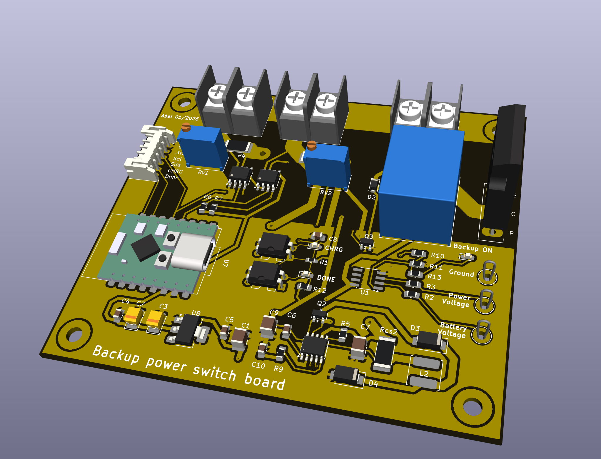
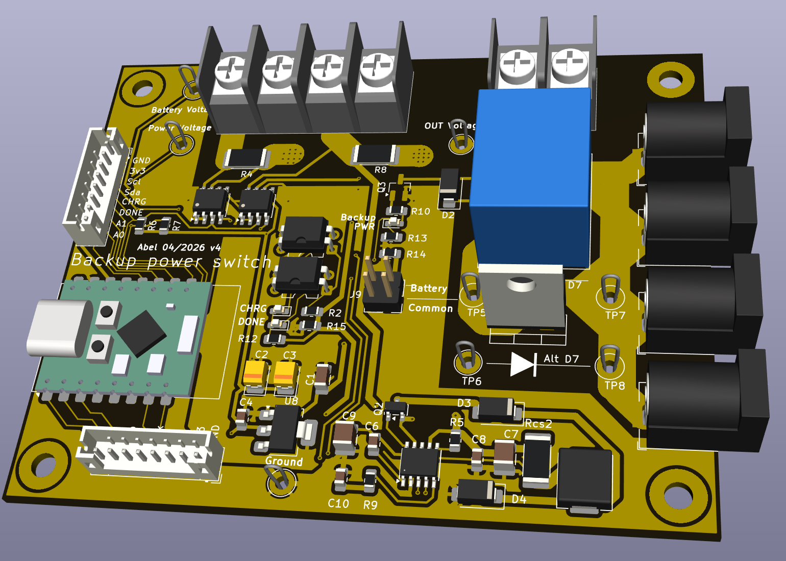
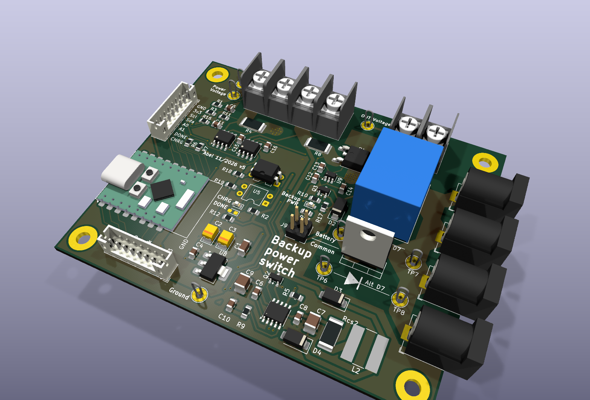

# Power backup board

12 V power switch with a 3S Li-ion backup. Loads run from the 12 V PSU and
switch to the battery when mains power is lost. An ESP32-C3 monitors voltages
and currents and controls the switchover.

## How it works

- **Switchover:** relay K1 (SRD-12VDC, driven by the ESP32-C3 through Q3 BSS138)
  selects PSU or battery for the outputs. Diode-OR D7 (MBRF3045CT) keeps the
  outputs powered while the relay changes over.
- **Reverse-current guard:** LM74700-Q1 (U9) with IRLR7843 (Q4) acts as an ideal
  diode on the battery leg. It stops the PSU from pushing current into the pack
  through the relay.
- **Charger:** CN3763 (U6) buck charger for a 3S pack with BMS, 1.2 A charge
  current (Rcs2 = 0.1 Ohm).
- **Monitoring:** two INA219 sensors on I2C: U2 (0x40) measures PSU current,
  U3 (0x45) measures battery current. 51k/10k dividers feed the PSU voltage
  (A0, GPIO0) and the battery voltage (A1, GPIO1) to the ADC.
- **Logic supply:** AMS1117-3.3 (U8). J9 selects its input source.

## Connectors

| Ref | Function |
|---|---|
| J1 | Screw terminal: battery and PSU inputs |
| J3 | Screw terminal: 12 V output |
| J4, J6, J7, J8 | 4x barrel jack 12 V outputs |
| J5 | External: GND, 3V3, SCL, SDA, A0, A1, DONE, CHRG |
| J2 | Display/UART: SPI (SCK, MOSI, MISO, SS), TX, RX, 3V3, GND |
| J9 | Logic supply selector |

## Versions

First version

Version v3.1

Current version v5.0

## Known issues and limitations (v5.0)

### Battery is not charged to 100 %

The CN3763 charger (U6) is a buck converter with a maximum duty cycle of 94 %,
so the pack voltage can never reach the charger input voltage. After the
losses in D3, Rcs2, Q2 and L2 the reachable pack voltage is roughly:

| PSU voltage | Pack voltage | Per cell | Usable capacity |
|---|---|---|---|
| 12.0 V | ~10.9 V | ~3.6 V | ~20-30 % |
| **12.6 V (recommended)** | **~11.2-11.4 V** | **~3.75-3.8 V** | **~45-55 %** |
| 13.2 V | ~11.7-11.9 V | ~3.9 V | ~60-70 % |

A full charge (12.6 V, 4.2 V/cell) needs about 14.1 V at the charger input.

Consequences:
- The charger never enters constant-voltage mode, so **DONE is never asserted**.
  D1 (DONE LED) and U5 (DONE optocoupler) are marked **DNP**.
- **CHRG stays on** (LED D5 lit, CHRG_SIG low) whenever the PSU is present.
  It means "PSU present, charger running", not "battery charging".
- Partial charge extends battery life considerably: calendar ageing at
  3.8 V/cell is much slower than at 4.2 V/cell.
- Most BMS boards balance only near 4.15-4.2 V/cell, so **cell balancing is not
  active**. Check individual cell voltages every few months.

Possible future fix: feed only the charger (U6 VCC, Q2 source, C6, C9) from a
separate 12 V to 15 V boost module (XL6019/XL6009 for 1.2 A charge current;
MT3608 only with Rcs2 = 0.2 Ohm, i.e. 0.6 A). The boost output must not be tied
to PWR OUT 12 +, otherwise 15 V reaches the loads through K1/D7.

### PSU voltage

Set the PSU to **12.6 V** (13.2 V maximum). Do not go higher: the outputs feed
12 V loads, and the AMS1117 (U8) is limited to 15 V input.

### Firmware notes

- Charge status: use the battery current from U3 (INA219, 0x45) and the pack
  voltage, not CHRG_SIG / DONE_SIG.
  - current into the pack > ~50-100 mA: charging;
  - ~0 A with PSU present: pack has reached its (partial) charge limit;
  - current out of the pack: running on battery.
- Low-voltage cutoff: drop the load at about **9.9 V (3.3 V/cell)**.
  The BMS only disconnects at 2.5-3.0 V/cell.
- GPIO2 is an ESP32-C3 strapping pin. It carries DONE_SIG and is pulled high
  by R19. **Do not populate U5**: it would pull GPIO2 low at reset and the ESP
  could fail to boot.
- Mains loss with the relay in the PSU position: the battery back-feeds
  PWR OUT / PWR IN through D7 and K1 NO, so the A0 divider still reads a near
  normal voltage. Detect mains loss by current instead (U2 current drops to ~0
  or goes negative, U3 shows discharge) and switch K1 to the battery.

### Other

- U8 AMS1117-3.3 dissipates about 0.9 W at 12.6 V input. The tab is VOUT
  (+3V3), not GND.
- Charge current is set by Rcs2: Ich = 120 mV / Rcs2 = 1.2 A with 0.1 Ohm.
- KiCad 10.0.x: writing to the board through the IPC API (BeginCommit) can
  crash KiCad when the schematic editor is loaded. Use the API read-only or
  open only the PCB editor.
